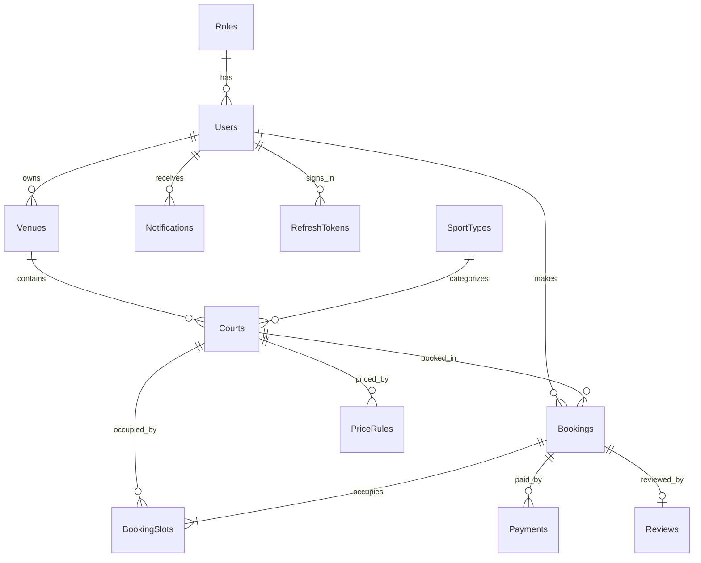

# SportHub – Hệ thống đặt sân thể thao


SportHub là nền tảng đặt sân thể thao trực tuyến (bóng đá mini, cầu lông, pickleball). Chủ sân đưa cơ sở, sân con và bảng giá theo khung giờ lên hệ thống; khách hàng tìm sân trống, đặt sân và thanh toán cọc trực tuyến.

> Dự án cá nhân đang trong quá trình phát triển. Xem mục [Lộ trình](#lộ-trình) để biết các chức năng đã hoàn thành và sắp làm.

---

## Mục lục

- [Chức năng](#chức-năng)
- [Bài toán kỹ thuật](#bài-toán-kỹ-thuật)
- [Công nghệ](#công-nghệ)
- [Kiến trúc](#kiến-trúc)
- [Cơ sở dữ liệu](#cơ-sở-dữ-liệu)
- [Cài đặt và chạy dự án](#cài-đặt-và-chạy-dự-án)
- [Danh sách API](#danh-sách-api)
- [Lộ trình](#lộ-trình)
- [Quy trình Git](#quy-trình-git)

---

## Chức năng

Hệ thống có 3 vai trò:

| Vai trò | Chức năng |
| --- | --- |
| **Customer** (khách hàng) | Đăng ký, đăng nhập; tìm cơ sở theo từ khóa, quận, môn thể thao; xem sân và bảng giá |
| **Owner** (chủ sân) | Tạo và cập nhật cơ sở; thêm sân con; cấu hình bảng giá theo khung giờ cho ngày thường và cuối tuần |
| **Admin** | Duyệt hoặc từ chối cơ sở mới; quản lý danh mục môn thể thao |

## Bài toán kỹ thuật

**1. Phiên đăng nhập an toàn (JWT + Refresh token)**
- Access token (JWT) sống 15 phút; refresh token sống 7 ngày để lấy access token mới mà không phải đăng nhập lại.
- Database chỉ lưu **hash SHA256** của refresh token, không lưu token gốc.
- **Rotation:** mỗi refresh token chỉ dùng được một lần, mỗi lần refresh sẽ cấp token mới.
- **Reuse detection:** nếu một token đã bị thu hồi mà vẫn được gửi lên (dấu hiệu bị đánh cắp), hệ thống thu hồi toàn bộ phiên của tài khoản đó.
- Mật khẩu được hash bằng **BCrypt**.

**2. Phân quyền theo tài nguyên (chống IDOR)**
- Ngoài phân quyền theo vai trò (`[Authorize(Roles = ...)]`), Service kiểm tra thêm quyền sở hữu: chủ sân chỉ xem và sửa được cơ sở, sân, bảng giá của chính mình.
- Định danh người dùng luôn lấy từ token, không lấy từ dữ liệu client gửi lên.

**3. Kiểm tra bảng giá theo khung giờ**
- Các khung giá phải là giờ tròn, **không chồng lấn**, **không bỏ trống** và phủ đúng từ giờ mở cửa đến giờ đóng cửa của cơ sở.
- Thuật toán: sắp xếp các khung theo giờ bắt đầu rồi so mỗi khung với khung liền trước, độ phức tạp O(n log n).
- Bảng giá được thay thế toàn bộ trong **một transaction**, nên luôn ở trạng thái hợp lệ.

**4. Tìm kiếm có lọc động và phân trang**
- Dùng `IQueryable` để ghép điều kiện lọc theo tham số người dùng gửi lên. Toàn bộ việc lọc, sắp xếp và phân trang được dịch thành một câu SQL.
- Dùng projection (`Select`) để chỉ lấy đúng các cột cần cho DTO.

**5. Chống đặt trùng sân** *(đang phát triển)*
- Mỗi booking được tách thành các khung 1 giờ trong bảng `BookingSlots`, kèm **unique constraint** trên `(CourtId, SlotDate, SlotStart)` để database chặn hai người đặt cùng một sân, cùng một giờ.

## Công nghệ

| Nhóm | Công nghệ |
| --- | --- |
| Backend | ASP.NET Core Web API (.NET 9) |
| ORM | Entity Framework Core 9 (Code First, Fluent API, Migrations) |
| Cơ sở dữ liệu | SQL Server |
| Xác thực | JWT Bearer, Refresh token, BCrypt |
| Tài liệu API | Swagger (Swashbuckle) |
| Quản lý mã nguồn | Git, GitHub (Git Flow: `main` – `dev` – `feature/*`) |
| Sắp triển khai | SignalR, Hangfire, VNPay Sandbox, ASP.NET Core MVC |

## Kiến trúc

Dự án tổ chức theo kiến trúc phân tầng **Controller → Service → Repository**:

```text
Client ──HTTP + JWT──▶ Controller ──▶ Service ──▶ Repository ──▶ EF Core ──▶ SQL Server
                       (nhận request,  (nghiệp vụ,   (truy cập
                        validate, DTO)  transaction)   dữ liệu)
```

| Tầng | Trách nhiệm |
| --- | --- |
| Controller | Nhận request, validate dữ liệu đầu vào, gọi Service, trả response |
| Service | Xử lý nghiệp vụ, kiểm tra quyền sở hữu, điều phối transaction |
| Repository | Đọc và ghi dữ liệu qua EF Core |

Các thành phần dùng chung:
- **Dependency Injection** cho toàn bộ Repository và Service.
- **Xử lý lỗi tập trung** (`IExceptionHandler`): mọi lỗi trả về theo chuẩn `ProblemDetails` với mã HTTP phù hợp (400, 401, 403, 404, 409, 500).
- **DTO** cho dữ liệu vào và ra, không trả Entity trực tiếp.

### Cấu trúc thư mục

```text
SportHub/
├── SportHub.API/
│   ├── Constants/         # Hằng số vai trò
│   ├── Controllers/       # API endpoints
│   ├── Data/
│   │   ├── AppDbContext.cs
│   │   └── Configurations/  # Fluent API cho từng bảng
│   ├── DTOs/              # Request / Response
│   ├── Entities/          # Các class ánh xạ bảng
│   ├── Enums/             # Trạng thái: Venue, Booking, Payment, DayType
│   ├── Exceptions/        # Exception nghiệp vụ
│   ├── Extensions/        # Extension method (lấy UserId từ token)
│   ├── Middlewares/       # GlobalExceptionHandler
│   ├── Migrations/
│   ├── Repositories/      # Interfaces + Implementations
│   ├── Services/          # Interfaces + Implementations
│   ├── Settings/          # Options pattern (JwtSettings)
│   └── Program.cs
└── SportHub.Web/          # Giao diện ASP.NET Core MVC (sắp triển khai)
```

## Cơ sở dữ liệu

12 bảng, thiết kế bằng EF Core Code First:



Một số ràng buộc quan trọng:
- Unique `Users.Email`, `Bookings.BookingCode`, `Payments.VnpTxnRef`, `RefreshTokens.TokenHash`.
- Unique `(Courts.VenueId, Courts.Name)`: tên sân không trùng trong cùng một cơ sở.
- Unique `(BookingSlots.CourtId, SlotDate, SlotStart)`: chống đặt trùng khung giờ.
- Check constraint `Reviews.Rating` từ 1 đến 5.
- `OnDelete(Restrict)` cho dữ liệu có giá trị lịch sử (User, Booking, Payment); `Cascade` cho dữ liệu chi tiết (BookingSlots, PriceRules).

## Cài đặt và chạy dự án

### Yêu cầu

- [.NET SDK 9](https://dotnet.microsoft.com/download/dotnet/9.0)
- SQL Server (Developer hoặc Express) và SQL Server Management Studio
- Công cụ EF Core: `dotnet tool install --global dotnet-ef --version 9.*`

### Các bước

**1. Clone repository**

```bash
git clone https://github.com/thinh2509/SportHub.git
cd SportHub
```

**2. Cấu hình chuỗi kết nối** trong `SportHub.API/appsettings.json` cho đúng tên SQL Server trên máy:

```json
"ConnectionStrings": {
  "DefaultConnection": "Server=localhost;Database=SportHubDb;Trusted_Connection=True;TrustServerCertificate=True;"
}
```

> Nếu dùng SQL Server Express, đổi thành `Server=localhost\\SQLEXPRESS`.

**3. Thiết lập khóa bí mật JWT** bằng User Secrets (không commit lên GitHub, khóa dài tối thiểu 32 ký tự):

```bash
dotnet user-secrets set "Jwt:Key" "<chuoi-ngau-nhien-dai-it-nhat-32-ky-tu>" --project SportHub.API
```

**4. Tạo database**

```bash
dotnet ef database update --project SportHub.API
```

Database được tạo kèm dữ liệu mẫu: 3 vai trò (Customer, Owner, Admin) và 3 môn thể thao.

**5. Chạy API**

```bash
dotnet run --project SportHub.API
```

Mở Swagger tại `http://localhost:<port>/swagger`. Số cổng hiển thị trong cửa sổ Terminal.

### Tạo tài khoản Admin để thử

Người dùng chỉ tự đăng ký được vai trò Customer hoặc Owner. Để có Admin, đăng ký một tài khoản rồi nâng quyền trong SSMS:

```sql
UPDATE Users SET RoleId = 3 WHERE Email = 'admin@test.com';
```

Trên Swagger, bấm **Authorize** và dán `accessToken` nhận được sau khi đăng nhập.

## Danh sách API

### Xác thực

| Method | Endpoint | Quyền | Mô tả |
| --- | --- | --- | --- |
| POST | `/api/auth/register` | Công khai | Đăng ký (Customer hoặc Owner) |
| POST | `/api/auth/login` | Công khai | Đăng nhập, nhận access token và refresh token |
| POST | `/api/auth/refresh` | Công khai | Đổi refresh token lấy cặp token mới |
| POST | `/api/auth/logout` | Công khai | Thu hồi refresh token |
| GET | `/api/auth/me` | Đã đăng nhập | Thông tin tài khoản hiện tại |

### Môn thể thao

| Method | Endpoint | Quyền | Mô tả |
| --- | --- | --- | --- |
| GET | `/api/sport-types` | Công khai | Danh sách môn thể thao |
| GET | `/api/sport-types/{id}` | Công khai | Chi tiết |
| POST | `/api/sport-types` | Admin | Thêm mới |
| PUT | `/api/sport-types/{id}` | Admin | Cập nhật |
| DELETE | `/api/sport-types/{id}` | Admin | Xóa (khi chưa có sân sử dụng) |

### Cơ sở (Venue)

| Method | Endpoint | Quyền | Mô tả |
| --- | --- | --- | --- |
| GET | `/api/venues` | Công khai | Tìm kiếm cơ sở đã duyệt (`keyword`, `district`, `sportTypeId`, `page`, `pageSize`) |
| GET | `/api/venues/{id}` | Công khai | Chi tiết cơ sở |
| GET | `/api/venues/mine` | Owner | Danh sách cơ sở của tôi |
| POST | `/api/venues` | Owner | Tạo cơ sở (trạng thái chờ duyệt) |
| PUT | `/api/venues/{id}` | Owner (chủ sở hữu) | Cập nhật cơ sở |
| GET | `/api/venues/pending` | Admin | Danh sách cơ sở chờ duyệt |
| PATCH | `/api/venues/{id}/approve` | Admin | Duyệt cơ sở |
| PATCH | `/api/venues/{id}/reject` | Admin | Từ chối cơ sở |

### Sân con và bảng giá

| Method | Endpoint | Quyền | Mô tả |
| --- | --- | --- | --- |
| GET | `/api/venues/{venueId}/courts` | Công khai | Sân đang hoạt động của cơ sở |
| GET | `/api/venues/{venueId}/courts/manage` | Owner (chủ sở hữu) | Tất cả sân, kể cả đang tạm ngưng |
| POST | `/api/venues/{venueId}/courts` | Owner (chủ sở hữu) | Thêm sân con |
| PUT | `/api/courts/{courtId}` | Owner (chủ sở hữu) | Cập nhật hoặc tạm ngưng sân |
| GET | `/api/courts/{courtId}/price-rules` | Công khai | Bảng giá của sân |
| PUT | `/api/courts/{courtId}/price-rules` | Owner (chủ sở hữu) | Thay thế toàn bộ bảng giá |

## Lộ trình

- [x] Thiết kế database, EF Core Code First, Fluent API, Migrations
- [x] Kiến trúc Controller – Service – Repository, xử lý lỗi tập trung, Swagger
- [x] Đăng ký, đăng nhập, JWT, phân quyền theo vai trò
- [x] Refresh token (rotation, reuse detection), đăng xuất
- [x] Quản lý cơ sở, quy trình Admin duyệt, tìm kiếm có phân trang
- [x] Quản lý sân con và bảng giá theo khung giờ
- [ ] Đặt sân: tính tiền theo khung giờ, transaction, chống đặt trùng
- [ ] Thanh toán cọc qua VNPay Sandbox
- [ ] Cập nhật lịch sân và thông báo theo thời gian thực bằng SignalR
- [ ] Tác vụ nền bằng Hangfire: tự hủy booking quá hạn, email nhắc lịch, dọn refresh token hết hạn
- [ ] Báo cáo doanh thu, xuất Excel
- [ ] Giao diện ASP.NET Core MVC

## Quy trình Git

- `main`: bản ổn định
- `dev`: nhánh phát triển chính
- `feature/<tên-chức-năng>`: mỗi chức năng một nhánh, tạo từ `dev` và merge lại `dev` khi hoàn thành

Commit message viết bằng tiếng Anh, bắt đầu bằng động từ (`Add`, `Fix`, `Update`...).

---

**Tác giả:** Nguyễn Phước Thịnh · [github.com/thinh2509](https://github.com/thinh2509) · phuocthinh25092004@gmail.com
